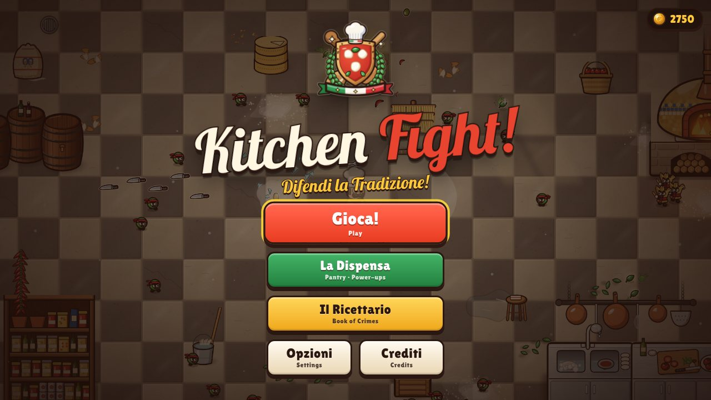
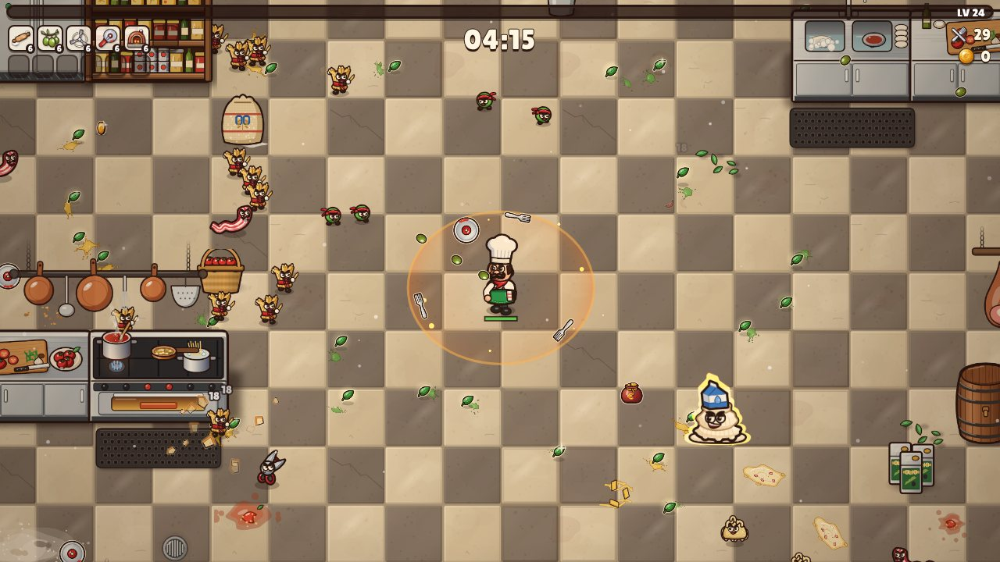
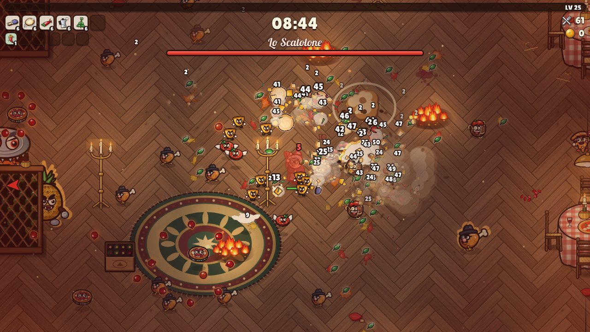
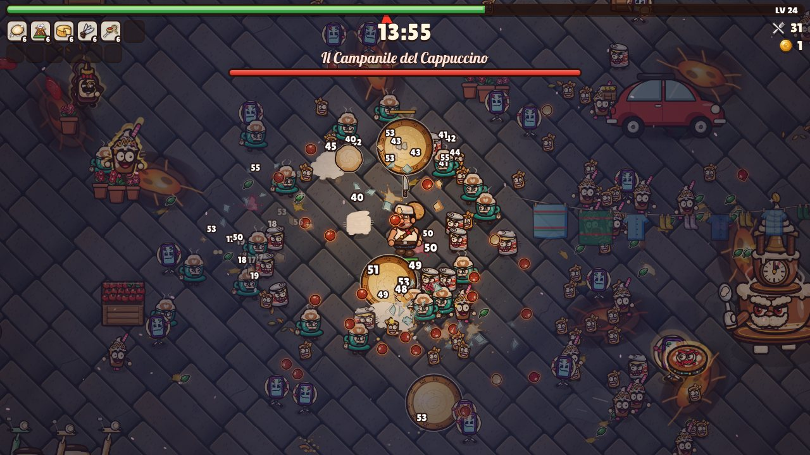
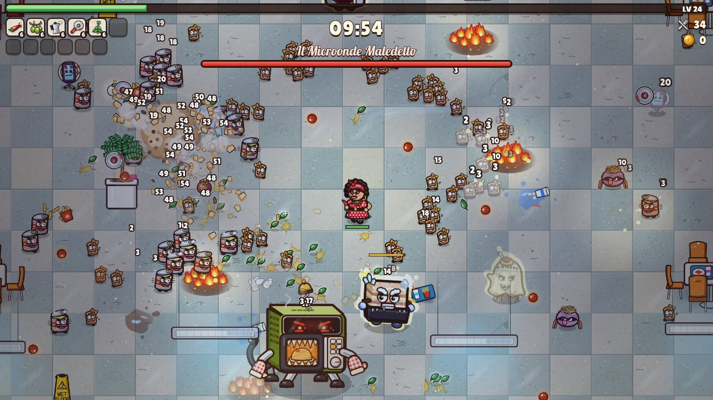
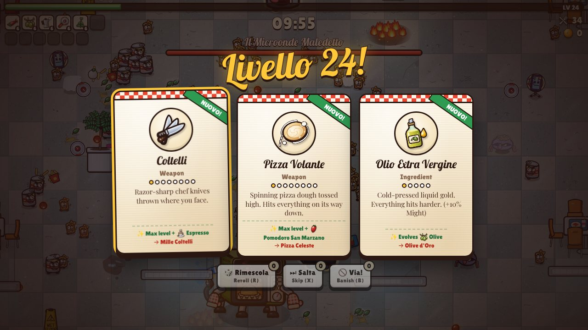
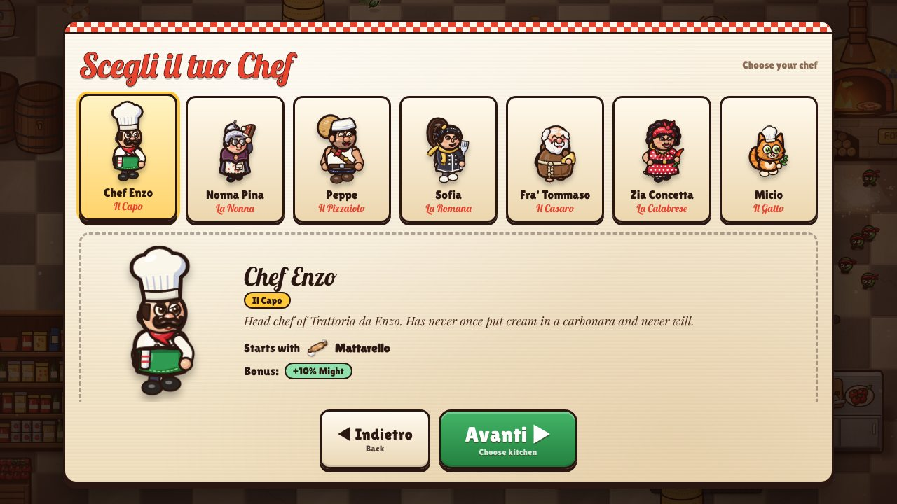
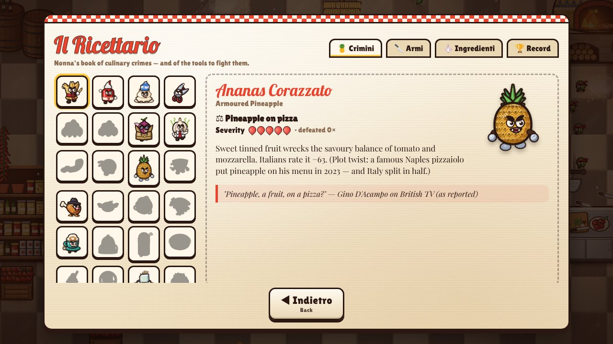

# 🍝 KITCHEN FIGHT — *Difendi la Tradizione!*

An Italian chef defends traditional cuisine against hordes of **culinary crimes** —
pineapple pizza, cream in the carbonara, ketchup on pasta, snapped spaghetti,
scissors, cappuccino after 11 a.m.… A top-down **survivors-like** arena game
(you steer; your kitchen arsenal fires on its own) that runs in any modern browser,
on desktop and mobile.

Every enemy is a real Italian food pet peeve, researched from Italian chefs,
institutions and social-media controversies — see **[docs/RESEARCH.md](docs/RESEARCH.md)**
(54 documented "crimes" with sources, e.g. Italians rank *ketchup on pasta* as their
#1 food crime in a 2022 YouGov survey).

<p align="center">
  
  
  
  
  
  
  
  
</p>

## ▶ Play

| How | Steps |
|-----|-------|
| **Instant (no install)** | Download [`play/kitchenfight.html`](play/kitchenfight.html) and double-click it. One self-contained file, works offline. |
| **Locally from source** | `npm install` then `npm run dev`, open the printed URL. |
| **GitHub Pages** | One-time: *Settings → Pages → Source: GitHub Actions*, then *Actions → Deploy to GitHub Pages → Run workflow*. (Set the repository variable `PAGES_ENABLED=true` to redeploy automatically on every push to `main`.) |

### Controls
- **Move:** WASD / arrow keys · gamepad stick or d-pad · on touch screens drag anywhere (floating joystick)
- Weapons fire automatically.
- **Pause:** Esc / P / gamepad Start (or the ❚❚ button on touch)
- **Level-up:** arrows + Enter (or click/tap) · **R** reroll · **X** skip · **B** banish

## 🍅 The game

- **4 stages** (15 minutes each, mini-bosses at 5:00 and 10:00, a final boss at 15:00):
  *La Cucina* (the kitchen) → *La Trattoria* (dining room by candlelight) →
  *I Vicoli di Napoli* (Naples alleys, sunset turning to night) → *La Food Court* (the lair where crimes are born).
- **7 chefs** with their own starting weapon and bonus — Chef Enzo, Nonna Pina (and her legendary flying slipper),
  Peppe il Pizzaiolo, Sofia la Romana, Fra' Tommaso the cheesemaking monk, Zia Concetta from Calabria, and Micio the trattoria cat.
- **14 weapons**, each evolving with a matching ingredient into **14 evolutions** (e.g. *Olive* + *Olio Extra Vergine* → *Olive d'Oro*;
  *Forma di Parmigiano* + *Salvadanaio* → *Forma d'Oro* — Parmigiano really is accepted as bank collateral in Emilia).
- **14 passive ingredients** (San Marzano tomatoes, Espresso, Nonna's apron, the lucky Cornicello…).
- **30 crimes + 10 bosses**, each with its own behaviour: the *Cold Pot* slows you down (Italians' #2 crime: starting pasta in cold water),
  *La Pentola Unica* (the infamous one-pot carbonara video) eats other enemies to grow, *Spaghetti Fantasma* (spaghetti bolognese
  "doesn't exist", says Bologna's former mayor) phases in and out, and the *Latecomer Cappuccino* only appears after 11:00.
- **La Dispensa** — spend coins on permanent power-ups. **Il Ricettario** — an illustrated encyclopedia of every crime with
  *why Italians object* and real quotes. Unlockable chefs and stages, records, settings (volume, shake, flashes, quality…).

## 🎨 How it's made

- **No image or audio files.** Every sprite is painted in code with vector shapes (`src/gfx/art/*`, toolkit in
  `src/gfx/painter.ts`) and cached to high-resolution bitmaps at load time. Music and sound effects are synthesized
  live with the Web Audio API (`src/audio/*`).
- TypeScript + Vite, no game framework. Custom engine: spatial hashing, pooled entities, y-sorted renderer with
  dynamic lighting, particles, decals, screen shake and hit-stop (`src/game/*`).
- DOM/CSS user interface styled like a trattoria menu card (`src/ui/*`, `src/styles/main.css`).

```
src/
  core/      input (keyboard, gamepad, touch), math, saves, spatial hash
  gfx/       painter toolkit, sprite cache, art modules (chefs, crimes, bosses, items, stages)
  audio/     synth instruments, sequencer, songs, sound effects
  game/      run simulation, weapons, passives, enemies, AI, bosses, waves, renderer, effects
  ui/        menus, HUD, level-up, chests, shop, encyclopedia
docs/        DESIGN.md (game design), RESEARCH.md (the food crimes), ART_GUIDE.md
```

### Scripts
| Command | What it does |
|---------|--------------|
| `npm run dev` | dev server with hot reload |
| `npm run build` | production build → `dist/` (static, any host) |
| `npm run build:single` | one self-contained HTML file → `dist-single/index.html` |
| `npm run typecheck` | TypeScript check |
| `/gallery.html` (dev) | sprite gallery & stage previews for art QA (`?prefix=enemy.&zoom=2`, `?stage=kitchen`) |

Dev helpers in `scripts/`: `shot.mjs` (screenshots), `play.mjs` (automated playtest), `sim.mjs` (headless 15-minute
balance simulation with a bot), `screens.mjs` (screenshots of every menu).

## Credits
Design, code, art, music and research by Claude (Anthropic) for this repository.
Fonts: Lobster, Lilita One, Playfair Display — SIL Open Font License.
No pineapples were harmed. Several were deeply offended.
